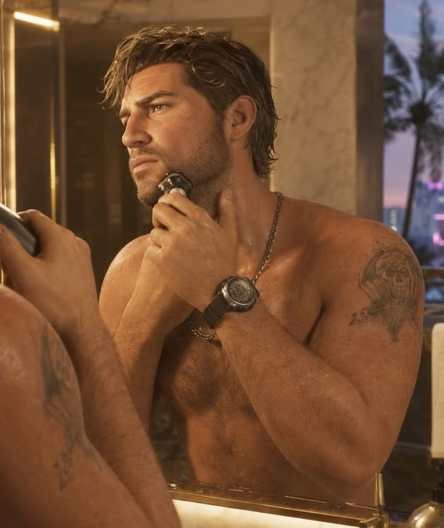
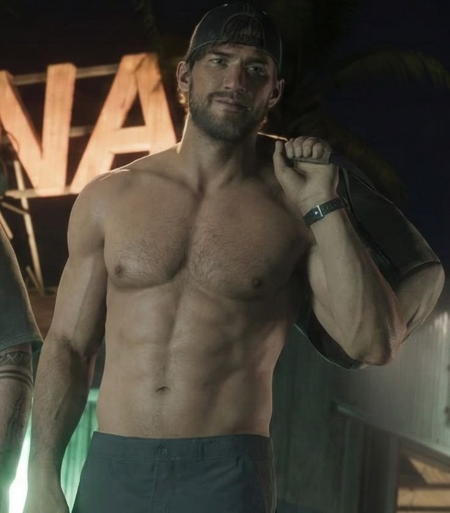
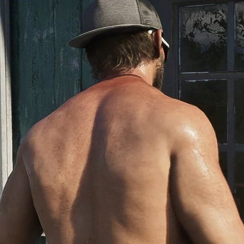

project duval · 001 — desired boyfriend · carbon copy · princess treatment · español + english

## Antes de empezar / Before we begin

<em>a little something about me</em>

holiii, quería contarles un poquito de mí antes de entrar en los beneficios de este audio. ♡

llevo por aquí desde más o menos 2019, y si se ponen a curiosear por mi canal probablemente encuentren algunos de mis subliminales de 2021 (sí, decidí dejarlos ahí JAJAJA).

les tengo bastante cariño porque son parte de una época en la que apenas estaba aprendiendo a crear mis propios audios. los subliminales me ayudaron muchísimo a lo largo de estos años y, entre tanta curiosidad por entender cómo se hacían y probar diferentes maneras de redactar mis afirmaciones, terminé creando los míos.

me gusta poder mirar atrás y ver cuánto ha cambiado mi forma de hacerlos.

este audio nació simplemente porque me hacía ilusión crearlo. normalmente hago mis audios para mí, pero esta vez pensé que sería bonito compartirlo con ustedes, por amor al arte y porque seguramente no soy la única que quedó enamorada de este hombre. JAJAJA.

espero que les guste tanto como a mí.

for my english-speaking lovelies...

hiii! i've been around the subliminal community since approximately 2019. if you explore my channel, you'll probably find some of the subliminals i made back in 2021.

i decided to keep them because they're a little reminder of where i started and how much my way of creating audios has changed over the years.

subliminals have helped me a lot personally, and my curiosity eventually led me to start making my own. most of the time i make them for myself, but i really wanted to share this particular one with you, simply because i enjoyed creating it.

and surely i'm not the only one who fell for this man... right?

i hope you love it as much as i do. ♡

<em>made for myself, shared with love.</em>

---

## 01. La fórmula / The formula

SYNERIS — selective alignment · personal growth · reciprocal connection

SYNERIS es una fórmula original que desarrollé especialmente para este audio. quería incluir el mayor nivel de detalle posible, desde las características físicas más pequeñas hasta la forma en la que se desarrolla una relación amorosa.

combina descripciones anatómicas, sensoriales y situacionales con afirmaciones enfocadas en tus preferencias románticas, tu autoconcepto y el crecimiento de ambos dentro de la relación.

SYNERIS is an original affirmation formula developed specifically for this audio. i wanted to include as much detail as possible, from the smallest physical characteristics to the way a loving relationship develops.

it combines anatomical, sensory and situational descriptions with affirmations centered on your romantic preferences, self-concept and mutual growth within the relationship.

| Español | English |
| :--- | :--- |
| hiperespecificidad anatómica | anatomical specificity |
| descripciones sensoriales | sensory descriptions |
| perspectivas múltiples | multiple perspectives |
| refuerzo integrado | integrated reinforcement |
| preferencias personalizables | customizable preferences |
| crecimiento personal | personal growth |
| visualización opcional | optional visualization |
| afirmaciones bilingües | bilingual affirmations |

<aside class="editorial-note">
  
una pequeña aclaración / a little clarification

  

    
incluí únicamente las características positivas que me gustan del personaje. las actividades cuestionables de gta se quedan dentro del juego, por favor JAJAJA.

  

  

    
only the positive characteristics i admire in the character are included. the questionable gta activities can stay in the game, please.

  

</aside>

---

## 02. Su rostro / His pretty face

<em>the kind of face you could stare at forever.</em>

### Estructura craneofacial / Craniofacial structure

parecido extraordinariamente fiel a jason duval en una apariencia humana y natural. cráneo masculino y robusto, frente amplia, curvatura frontal proporcionada, región glabelar definida, sienes armoniosas y arcos supraorbitarios prominentes.

an extraordinarily faithful resemblance to jason duval in a realistic human appearance. robust masculine skull, broad forehead, proportionate frontal curvature, defined glabellar region, harmonious temples and prominent brow ridges.

| Más detalles | Further details |
| :--- | :--- |
| rostro ligeramente rectangular | slightly rectangular face |
| contornos faciales angulares | angular facial contours |
| pómulos definidos | defined cheekbones |
| arcos cigomáticos visibles | visible zygomatic contours |
| mejillas discretamente hundidas | subtly hollow cheeks |
| tejidos blandos proporcionados | balanced soft tissue distribution |
| mandíbula ancha y angular | broad angular jawline |
| ramas mandibulares definidas | defined mandibular rami |
| músculos maseteros proporcionados | proportionate masseter muscles |
| ángulos mandibulares marcados | prominent mandibular angles |
| borde mandibular firme | firm lower mandibular border |
| mentón ancho y ligeramente cuadrado | broad, slightly square chin |
| tercios faciales armoniosos | harmonious facial thirds |
| profundidad y proyección facial | facial depth and projection |

### Sus ojos / His eyes

ojos claros con matices azules, grises y verdes. pigmentación detallada del iris, fibras radiales, profundidad cromática, pupilas naturales y contornos limbales definidos.

forma ligeramente almendrada, órbitas profundas, párpados superiores parcialmente encapotados, pliegues palpebrales naturales y una exposición armoniosa del iris.

light-colored eyes with blue, gray and green undertones. detailed iris pigmentation, radial fibers, chromatic depth, natural pupils and defined limbal contours.

slightly almond-shaped eyes, deep-set orbits, partially hooded upper eyelids, natural eyelid folds and harmonious iris exposure.

| Español | English |
| :--- | :--- |
| cantos oculares proporcionados | proportionate eye corners |
| pestañas naturales | natural eyelashes |
| cejas castañas y densas | thick brown eyebrows |
| cejas ligeramente inclinadas | subtly angled eyebrows |
| distribución natural del vello | natural eyebrow hair distribution |
| mirada intensa y masculina | intense masculine gaze |
| expresiones cálidas al verte | warm expressions when he sees you |

  
<em>esos ojos, dios mío.</em>

  
<em>those eyes. that's it. that's the benefit.</em>

### Nariz, labios y sonrisa / Nose, lips & smile

| Español | English |
| :--- | :--- |
| raíz nasal definida | defined nasal root |
| transición nasofrontal natural | natural nasofrontal transition |
| puente nasal relativamente recto | relatively straight nasal bridge |
| dorso nasal firme | firm nasal dorsum |
| punta nasal estructurada | structured nasal tip |
| proyección nasal proporcionada | proportionate nasal projection |
| aletas nasales masculinas | masculine nasal wings |
| fosas nasales naturales | natural nostrils |
| columela armoniosa | harmonious columella |
| perfil nasal masculino | masculine nasal profile |
| filtrum definido | defined philtrum |
| arco de cupido definido | defined cupid's bow |
| labio superior moderadamente fino | moderately thin upper lip |
| labio inferior más voluminoso | slightly fuller lower lip |
| comisuras expresivas | expressive lip corners |
| dentadura natural | natural teeth |
| sonrisa ladeada característica | distinctive crooked grin |
| movimientos faciales naturales | natural facial movements |

### Piel, cabello y barba / Skin, hair & beard

piel de tonalidad cálida y ligeramente bronceada, pigmentación natural, poros, microrelieves cutáneos, vello fino, variaciones cromáticas y líneas de expresión.

cabello castaño, corto, ligeramente grueso y naturalmente denso, con implantación masculina, laterales rebajados y dirección de crecimiento característica.

barba corta, bigote, patillas y vello mandibular que enmarcan naturalmente su rostro.

orejas proporcionadas, incluyendo hélix, antihélix, tragos, lóbulos e implantación auricular.

warm, lightly tanned skin with natural pigmentation, pores, subtle surface details, fine body hair, tonal variations and expression lines.

short, slightly coarse and naturally dense brown hair, with a masculine hairline, closely trimmed sides and distinctive growth direction.

short beard, mustache, sideburns and mandibular facial hair naturally framing his face.

proportionate ears, including helices, antihelices, tragi, earlobes and ear positioning.

<aside class="editorial-note">
  
parecido tridimensional / three-dimensional resemblance

  

    
su identidad visual permanece reconocible desde el frente, ambos perfiles, tres cuartos, diferentes distancias, iluminaciones, expresiones y movimientos, incluso cuando cambia su peinado o longitud de barba.

  

  

    
his visual identity remains recognizable from the front, both profiles, three-quarter perspectives, different distances, lighting conditions, expressions and movements, even when his hairstyle or beard length changes.

  

</aside>

---

## 03. Su físico / His physique

  
<em>bueno, ustedes entienden...</em>

  
<em>yeah, you get it.</em>

constitución atlética, musculosa y masculina, con proporciones corporales naturales y funcionales. silueta en v, hombros amplios, espalda ancha y cintura relativamente estrecha.

an athletic, muscular masculine physique with natural and functional body proportions. a v-shaped silhouette, broad shoulders, wide back and relatively narrow waist.

### Anatomía corporal / Body anatomy

| Español | English |
| :--- | :--- |
| cuello fuerte | strong neck |
| esternocleidomastoideos definidos | defined sternocleidomastoid muscles |
| trapecios desarrollados | developed trapezius muscles |
| clavículas definidas | defined collarbones |
| hombros amplios | broad shoulders |
| deltoides redondeados | rounded deltoids |
| pectorales firmes | firm pectoral muscles |
| dorsales anchos | wide latissimus muscles |
| bíceps desarrollados | developed biceps |
| tríceps definidos | defined triceps |
| braquiorradiales proporcionados | proportionate brachioradialis muscles |
| antebrazos musculosos | muscular forearms |
| abdomen definido | defined abdominal muscles |
| oblicuos y serratos definidos | defined obliques and serratus muscles |
| vascularización natural | natural vascularity |
| pelvis proporcionada | proportionate pelvis |
| glúteos desarrollados | developed glutes |
| cuádriceps e isquiotibiales definidos | defined quadriceps and hamstrings |
| pantorrillas proporcionadas | proportionate calves |
| tobillos y pies armoniosos | harmonious ankles and feet |

### Los pequeños detalles / The finer details

- manos masculinas, palmas proporcionadas y dedos fuertes.
- articulaciones, nudillos y tendones definidos.
- uñas cuidadas, textura cutánea y vello corporal natural.
- musculatura funcional y movimientos anatómicos coherentes.
- altura, edad adulta y tatuajes personalizables.

- masculine hands, proportionate palms and strong fingers.
- defined joints, knuckles and visible tendons.
- well-maintained nails, realistic skin texture and natural body hair.
- functional musculature and coherent anatomical movements.
- customizable height, adult age and tattoos.

---

## 04. Su voz y presencia / Voice & presence

  
<em>imagina escuchar esa voz diciendo tu nombre.</em>

  
<em>imagine hearing him say your name.</em>

### Su voz / His voice

- voz masculina, grave, cálida, resonante y ligeramente áspera.
- timbre y frecuencia vocal percibida similares a los de jason.
- cadencia relajada, articulación y pronunciación atractivas.
- respiración, intensidad, pausas, entonación y risa características.
- fluidez en el idioma que prefieras.

- deep, warm, resonant and slightly raspy masculine voice.
- distinctive timbre and perceived vocal pitch resembling jason's.
- relaxed cadence, attractive articulation and pronunciation.
- distinctive breathing, intensity, pauses, intonation and laughter.
- fluency in your preferred language.

### Su presencia / His presence

- postura segura y movimientos relajados.
- pasos firmes y forma de caminar característica.
- gestos manuales, inclinaciones de cabeza y movimientos de cejas.
- sonrisas ladeadas y expresiones espontáneas.
- mirada cálida y alegría genuina al verte.
- aroma personal agradable, perfume e higiene.
- calor corporal y abrazos reconfortantes.
- estilo masculino casual, elegante y deportivo.
- parecido reconocible durante sus actividades cotidianas.

- confident posture and relaxed movements.
- firm footsteps and distinctive walking style.
- characteristic hand gestures, head tilts and eyebrow movements.
- subtle crooked smiles and spontaneous expressions.
- warm gaze and genuine happiness when he sees you.
- pleasant personal scent, fragrance and hygiene.
- comforting body warmth and embraces.
- masculine casual, elegant and athletic style.
- recognizable resemblance throughout everyday activities.

---

## 05. Su personalidad / His personality

por muy lindo que sea, también quería que fuera alguien con quien realmente pudieras construir algo bonito. de nada sirve que sea idéntico a jason si te va a hacer pasar malos ratos.

as gorgeous as he is, i also wanted him to be someone you could genuinely build something beautiful with. looking like jason means very little if he doesn't treat you well.

| Personalidad | Personality |
| :--- | :--- |
| seguro de sí mismo | self-confident |
| valiente y decidido | courageous and decisive |
| inteligente e ingenioso | intelligent and resourceful |
| carismático y divertido | charismatic and playful |
| trabajador y disciplinado | hardworking and disciplined |
| responsable y confiable | responsible and trustworthy |
| honesto y fiel | honest and faithful |
| cariñoso y paciente | affectionate and patient |
| emocionalmente disponible | emotionally available |
| sensible y tierno contigo | sensitive and tender toward you |

también incluí regulación emocional, autocontrol bajo presión, comunicación respetuosa, capacidad de reconocer sus errores, cumplir promesas y reparar desacuerdos.

su masculinidad se expresa mediante iniciativa, integridad, prudencia y protección respetuosa. lleva una vida segura, legal, estable y constructiva.

also includes emotional regulation, self-control under pressure, respectful communication, acknowledging mistakes, keeping promises and resolving disagreements.

his masculinity is expressed through initiative, integrity, prudence and respectful protection. he enjoys a safe, lawful, stable and constructive lifestyle.

---

## 06. Provider boyfriend

<em>que también te consientan un poquito, o muchísimo. ♡</em>

### Prosperidad / Prosperity

- riqueza abundante de origen legítimo.
- ingresos, patrimonio, ahorros e inversiones.
- estabilidad y administración financiera responsable.
- generosidad espontánea, constante y sostenible.
- disfruta compartir sus recursos voluntariamente.
- le nace invitarte y pagar por sus citas.
- te ofrece comodidades, regalos y experiencias.
- respeta tu independencia económica.

- abundant legitimate wealth.
- income, assets, savings and investments.
- financial stability and responsible money management.
- spontaneous, consistent and sustainable generosity.
- genuinely enjoys sharing his resources voluntarily.
- enjoys treating you and paying for dates.
- offers comforts, gifts and memorable experiences.
- respects your financial independence.

<aside class="editorial-note">
  
su lado protector / his protective side

  

    
se interesa genuinamente por tu seguridad, te acompaña cuando lo deseas, considera tu comodidad y te ofrece soluciones prácticas cuando necesitas ayuda.

    
su protección nace del cuidado y el cariño, respetando tu privacidad, libertad y decisiones personales.

  

  

    
he genuinely cares about your safety, accompanies you whenever desired, considers your comfort and offers practical solutions when you need support.

    
his protection comes from affection and care, while respecting your privacy, freedom and personal decisions.

  

</aside>

---

## 07. Princess treatment

<em>it's all in the little things, really.</em>

esta es probablemente una de mis partes favoritas del audio. quería incluir hasta esos detallitos que parecen insignificantes, pero que se sienten demasiado bonitos cuando vienen de alguien que quieres.

this is probably one of my favorite parts of the audio. i wanted to include even the smallest gestures that feel incredibly special when they come from someone you love.

### Los pequeños detalles / The little things

te abre las puertas, te ofrece su brazo, te presta su abrigo, te ayuda a cargar cosas pesadas y procura tu comodidad.

recuerda tus flores favoritas, tus comidas preferidas, fechas importantes, deseos, conversaciones y esos pequeños comentarios que quizás ni siquiera recuerdas haberle contado.

he opens doors for you, offers you his arm, lends you his jacket, helps carry heavy things and considers your comfort.

he remembers your favorite flowers, foods, important dates, wishes, conversations and those little comments you might not even remember mentioning.

### Las citas y los regalos / Dates & gifts

toma la iniciativa de planear citas románticas, reservar restaurantes, organizar escapadas y preparar sorpresas.

te regala flores, chocolates, cartas, detalles personalizados y experiencias significativas. cumple los planes que propone y busca pequeñas maneras de hacerte sonreír.

he takes the initiative to plan romantic dates, reserve restaurants, organize getaways and prepare surprises.

he gives you flowers, chocolates, letters, personalized gifts and meaningful experiences. he follows through on his plans and finds little ways to make you smile.

### Sus demostraciones de amor / His affection

te envía mensajes cariñosos, pregunta por tu día, escucha tus historias y se interesa por lo que piensas.

te mira con admiración, sonríe al verte llegar, te toma de la mano, acaricia tu cabello, te abraza y te besa cuando ambos desean ese contacto.

admira tu inteligencia, belleza, personalidad, capacidades y ambiciones. celebra tus logros y reconoce orgullosamente su relación contigo, en público y en privado.

he sends affectionate messages, asks about your day, listens to your stories and takes an interest in your thoughts.

he looks at you with admiration, smiles when you arrive, holds your hand, strokes your hair, embraces you and kisses you whenever you both desire closeness.

he admires your intelligence, beauty, personality, capabilities and ambitions. he celebrates your achievements and proudly acknowledges your relationship, publicly and privately.

### Durante los días difíciles / On difficult days

cuando estás triste, escucha y valida tus emociones. cuando estás cansada, respeta tu descanso. cuando estás enferma, te ofrece cuidados prácticos.

cuando tienes dificultades, te pregunta cómo puede ayudarte. su cariño permanece presente durante las rutinas y los momentos complicados.

when you're sad, he listens and validates your emotions. when you're tired, he respects your rest. when you're unwell, he offers practical care.

when you're struggling, he asks how he can help. his affection remains consistent throughout everyday routines and challenging moments.

  
<em>qué bonito que alguien te conozca hasta en los detalles más pequeños.</em>

  
<em>being loved gently is such a beautiful thing.</em>

---

## 08. El encuentro / Finding each other

| Español | English |
| :--- | :--- |
| encuentro natural y seguro | natural and safe encounter |
| cercanía geográfica | convenient geographical proximity |
| edad adulta de tu preferencia | your preferred adult age |
| disponibilidad sentimental | romantic availability |
| idioma de tu preferencia | your preferred language |
| valores compatibles | compatible values |
| intereses y objetivos compatibles | compatible interests and goals |
| atracción mutua y genuina | genuine mutual attraction |
| libertad de elección | freedom of choice |

el acercamiento romántico surge de manera natural y se desarrolla mediante una atracción auténtica y recíproca, en circunstancias compatibles con sus vidas.

your romantic connection develops naturally through genuine and reciprocal attraction, in circumstances compatible with both of your lives.

---

## 09. La relación / Your love story

<em>the kind of love that feels like coming home.</em>

### Sus momentos juntos / Your moments together

- conversaciones profundas y bromas privadas.
- complicidad y química romántica intensa.
- viajes, comidas especiales y experiencias memorables.
- mañanas tranquilas y noches románticas.
- intimidad física y emocional consentida.
- interés y curiosidad mutua con el paso de los años.
- cariño expresado mediante los cinco lenguajes del amor.

- deep conversations and private jokes.
- playful connection and intense romantic chemistry.
- travels, special meals and memorable experiences.
- peaceful mornings and romantic evenings.
- consensual physical and emotional intimacy.
- mutual interest and curiosity throughout the years.
- affection expressed through all five love languages.

### Construir algo juntos / Building something together

- confianza, fidelidad acordada y compromiso.
- comunicación asertiva y escucha activa.
- resolución de conflictos mediante empatía.
- disculpas sinceras y cambios de comportamiento.
- respeto por los límites y la privacidad.
- respeto por las amistades y responsabilidades individuales.
- estabilidad emocional y reciprocidad.
- convivencia, proyectos y futuro según sus deseos mutuos.

- trust, mutually agreed faithfulness and commitment.
- assertive communication and attentive listening.
- conflict resolution through empathy.
- sincere apologies and meaningful behavioral changes.
- respect for boundaries and privacy.
- respect for individual friendships and responsibilities.
- emotional stability and reciprocity.
- shared living arrangements, projects and a future shaped by mutual desires.

---

## 10. También pensé en ti / Self concept

me parecía importante incluir afirmaciones para ti también. quiero que puedas recibir todo ese cariño, pero que también te sientas capaz de corresponderlo, comunicar lo que necesitas y seguir creciendo como persona.

tus sueños, tus amistades y todo aquello que te hace ser tú siguen siendo igual de importantes cuando estás enamorada.

i felt it was important to include affirmations for you, too. i want you to feel comfortable receiving all that affection while also being able to reciprocate it, communicate your needs and continue growing as a person.

your dreams, friendships and everything that makes you who you are remain just as important when you're in love.

| Tu crecimiento | Your growth |
| :--- | :--- |
| autoestima independiente de la relación | self-esteem independent of relationship status |
| reconocimiento de tu valor | recognition of your worth |
| seguridad personal | personal confidence |
| regulación emocional | emotional regulation |
| comunicación asertiva | assertive communication |
| expresión de necesidades | expressing your needs |
| manejo saludable de celos | healthy management of jealousy |
| manejo de inseguridades | management of insecurities |
| distinguir hechos de suposiciones | distinguishing facts from assumptions |
| responsabilidad afectiva | emotional accountability |
| recibir amor con gratitud | receiving affection with gratitude |
| corresponder mediante acciones | reciprocating love through actions |
| conservar amistades y estudios | maintaining friendships and education |
| conservar metas profesionales | preserving career goals |
| conservar tus ambiciones | preserving personal ambitions |
| autonomía y libertad de elección | autonomy and freedom of choice |
| reconocer compatibilidad genuina | recognizing genuine compatibility |
| elegir relaciones saludables | choosing healthy relationships |

  
<em>tú también mereces todo ese amor que tienes para ofrecer.</em>

  
<em>you deserve the love you offer.</em>

---

## 11. Hazlo tuyo / Make it yours

aunque nos guste el mismo personaje, es normal que tengamos gustos diferentes. por eso dejé algunos detalles abiertos a tus preferencias personales.

even if we're attracted to the same character, it's perfectly natural to have different preferences. that's why i left some details open to personal choice.

| Personalizable | Customizable |
| :--- | :--- |
| edad adulta | adult age |
| altura | height |
| idioma | language |
| tatuajes | tattoos |
| detalles estéticos | aesthetic details |
| peinado y longitud de barba | hairstyle and beard length |
| ubicación compatible | compatible location |
| estilo de vida | lifestyle |
| futuro romántico mutuo | mutually desired romantic future |

no necesitas conocer todos los términos anatómicos ni visualizar cada característica. las descripciones ya forman parte de las afirmaciones.

you don't need to know every anatomical term or visualize each characteristic. the descriptions are already included in the affirmations.

---

## 12. Antes de escuchar / Listening notes

| Español | English |
| :--- | :--- |
| audífonos opcionales | headphones optional |
| visualización opcional | visualization optional |
| refuerzo incluido | reinforcement included |
| sin cantidad obligatoria de escuchas | no mandatory listening count |
| afirmaciones en español e inglés | spanish and english affirmations |
| volumen cómodo | comfortable volume |

las afirmaciones están diseñadas para escucharse aceleradas debajo de la música, así que posiblemente percibas algunos murmullos.

puedes disfrutar del audio independientemente de tus creencias. tampoco quiero que sientas presión por escuchar cierta cantidad de veces o estar buscando resultados constantemente.

si experimentas alguna molestia, deja de escucharlo y descansa. disfruta el proceso a tu ritmo.

este audio está pensado para afirmaciones, reflexión y disfrute personal. cada experiencia es diferente y no se garantizan resultados externos.

the affirmations are designed to be accelerated underneath the music, so you might notice some murmuring.

you can enjoy the audio regardless of your beliefs. i don't want you to feel pressured to listen a certain number of times or constantly look for results.

if you experience any discomfort, stop listening and rest. enjoy the experience at your own pace.

this audio is intended for affirmations, reflection and personal enjoyment. individual experiences vary, and external manifestation results aren't guaranteed.

---

## Antes de irte / Before you go

gracias por tomarte el tiempo de leer todo esto. sé que quedó bastante largo, pero quería prestarles atención hasta a los detalles más pequeños.

si llegaste hasta aquí, espero que disfrutes mucho el audio y que algún día tengas una historia de amor que te haga sonreír cada vez que la recuerdes.

si les nace compartir sus experiencias en los comentarios, me encantaría leerlas. ♡

thank you for taking the time to read all of this. i know it's quite long, but i really wanted to pay attention to even the smallest details.

if you've made it this far, i hope you enjoy the audio and that someday you'll have a love story that makes you smile whenever you think about it.

if you ever feel like sharing your experiences in the comments, i'd love to read them. ♡

  Syneris
  <em>for the hopeless romantics, with love.</em>
  subliminal no. 001 · project duval ♡

